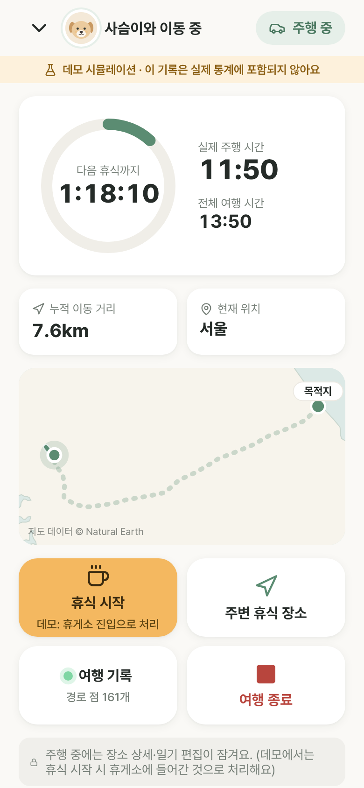
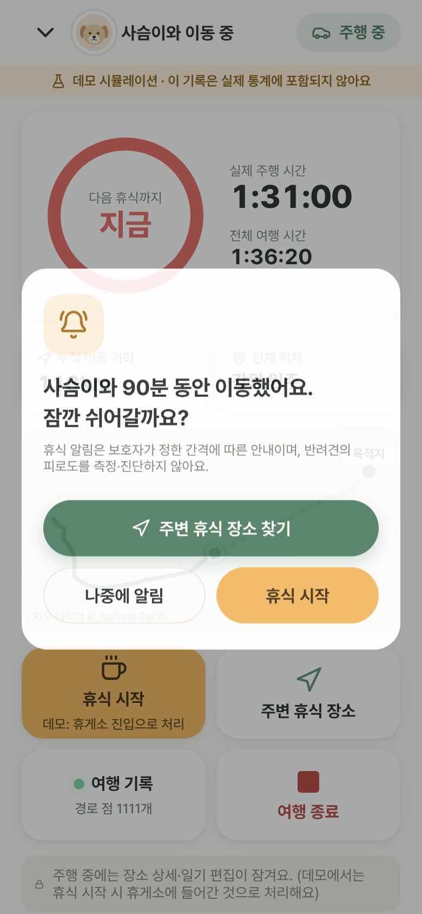
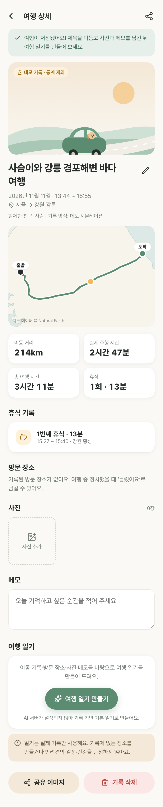
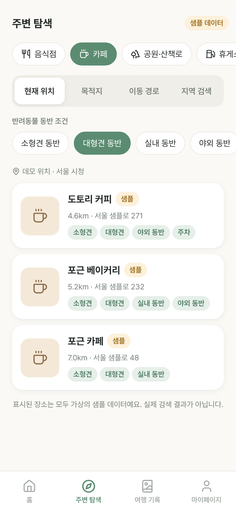
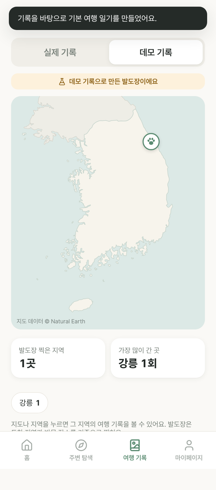
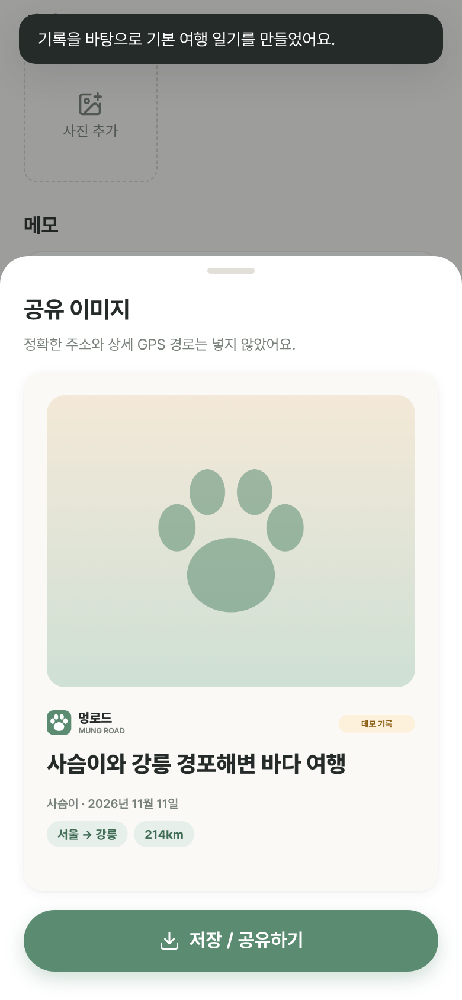
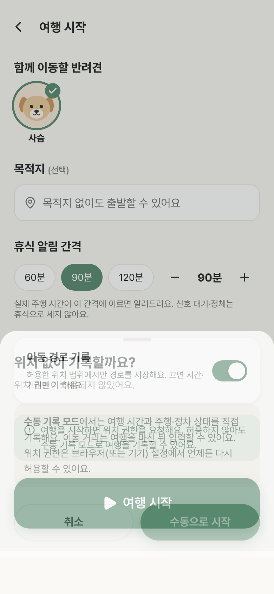

# 멍로드 (MUNG ROAD)

> 우리 강아지와 함께 달린 모든 길이 추억이 된다.

반려견과의 자동차 여행을 자동으로 기록하고, 주행 시간에 따른 휴식 알림, 주변 반려동물 동반 장소 검색,
여행 앨범·AI 여행 일기를 제공하는 **스마트 펫 트래블 로그** 서비스입니다.
현대자동차 차량용 앱 개발 공모전(패밀리 & 동승자 케어 / 모빌리티 & 라이프 편의) 출품작입니다.

## 저장소 구성

| 폴더 | 내용 | 상태 |
|---|---|---|
| [`web/`](web) | **실제 동작하는 웹 프로토타입** (React + TypeScript + Vite). 전체 사용자 흐름과 데모 시나리오 | ✅ 빌드·단위 테스트 17개·E2E 시나리오 통과 |
| [`android/`](android) | 최종 목표인 Pleos Connect용 Android 앱 골격 (Kotlin, Room, Compose, VehicleDataProvider) | ⚠ 코드 작성, **컴파일 미검증** |
| [`server/`](server) | AI 일기·장소 검색 프록시 (API 키를 서버에만 보관) | ✅ 라우팅 확인 / ⚠ 외부 API 실호출 미검증 |
| [`docs/`](docs) | 구현 현황, 아키텍처, Pleos SDK 조사 | |

> 개발 환경에서 Android SDK·Gradle 저장소에 접근할 수 없어, 요청서 2장 방침에 따라 **웹 프로토타입을 먼저 완성**했습니다.
> 실제 구현 범위와 미구현 범위는 [`docs/IMPLEMENTATION_STATUS.md`](docs/IMPLEMENTATION_STATUS.md)에 정리했습니다.

## 웹 프로토타입 실행

```bash
cd web
npm install
npm run dev        # http://localhost:5173
npm test           # 도메인 단위 테스트 (vitest)
npm run build      # dist/ 정적 파일 (상대 경로라 어디서든 호스팅 가능)
```

E2E 데모 시나리오 점검(Chrome 필요):

```bash
npm run build && npx vite preview --port 4173 &
node e2e/demo-scenario.mjs /path/to/chrome   # e2e/screenshots/ 에 화면 캡처 저장
```

### 공모전 시연 순서 (데모 모드, 기본 켜짐)
1. 온보딩 3장 → 반려견 등록(예: 사슴)
2. 홈 → **여행 시작하기** → 시뮬레이션 속도(예: 60배속) 선택 → 여행 시작
3. 서울 → 영동고속도로 → 강릉 가상 주행: 주행 시간·거리 증가, 경로 표시
   - 신호 대기·정체 정차는 '일시 정차'로만 표시되고 휴식으로 세지 않음
   - 일부러 넣은 비정상 GPS 좌표(순간 이동, 저정확도, 0,0)가 걸러짐 (‘여행 기록’ 버튼에서 확인)
4. 주행 80분 예고 → 90분 휴식 알림 (음성 안내 포함) → 주변 휴식 장소(샘플) → 휴식 시작/종료
5. 도착 → 여행 종료 → 자동 제목("사슴이와 강릉 경포해변 바다 여행") → 사진·메모 → 여행 일기 생성 → 공유 이미지
6. 여행 기록 › 데모 기록 / 발도장 지도 확인. 데모 기록은 홈·마이페이지 누적 통계에 포함되지 않음

### AI 일기 / 실제 장소 검색 연결 (선택)
```bash
ANTHROPIC_API_KEY=... KAKAO_REST_API_KEY=... node server/index.mjs   # :8787
```
앱 › 마이페이지 › 연동 서버에 `http://localhost:8787` 입력. 서버가 없거나 실패하면 기록 기반 기본 일기·샘플 장소로 자동 대체됩니다.

## 기술 스택
- Web: React 19, TypeScript, Vite, IndexedDB(idb), Lucide 아이콘, Pretendard 폰트, Natural Earth 해안선 SVG 지도
- Android(목표): Kotlin, Jetpack Compose, MVVM, Room, Coroutines/Flow, AAOS Car API, Pleos Connect SDK

## 라이선스 고지
Pretendard(OFL-1.1), Lucide(ISC), Natural Earth(퍼블릭 도메인) / world-atlas(ISC). 일러스트는 자체 제작 SVG이며, 반려견·여행 사진은 사용자가 직접 등록한 사진만 사용합니다.

## 화면 (E2E 자동 캡처)
| 홈 | 여행 중 | 휴식 알림 | 여행 상세 |
|---|---|---|---|
|  |  |  |  |
| **주변 탐색** | **발도장 지도** | **공유 이미지** | **위치 권한 거부** |
|  |  |  |  |
